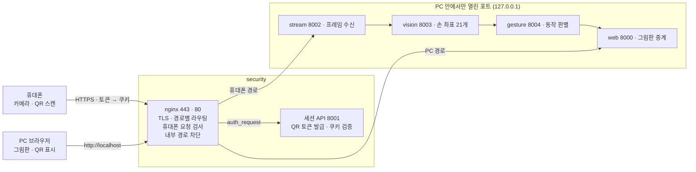

# security 파트 코드 분석 보고서

2026-10-29 · 김도은

## 개요

security는 휴대폰과 PC 브라우저가 들어오는 유일한 출입구로, HTTPS 처리·경로별 라우팅·QR 세션 인증을 맡는다. 설계 문서(`docs/architecture.html`)와 계약 문서(`docs/contracts/README.md`)의 security 항목을 모두 구현했고, PR #5와 #8로 dev에 합쳐졌다.

- 담당: 김도은
- 구성: nginx(443 HTTPS, 80 PC 전용) + 세션 API(FastAPI, 8001)를 한 컨테이너에서 실행
- 핵심: QR 1회용 토큰(60초) → HttpOnly 쿠키 → nginx `auth_request`로 휴대폰 요청 검사
- 검증: 자동 테스트 18개 통과, Docker 실행 환경에서 보안 점검 통과, 실제 휴대폰으로 카메라 연결 확인

## 전체 구조



휴대폰과 PC 브라우저는 security로만 들어오고, 나머지 네 서비스는 Docker 내부망에서만 서로 부른다. 휴대폰 경로(`/m/`, `/ws/stream`)는 nginx가 세션 API에 먼저 물어본 뒤 stream으로, PC 경로(`/`, `/ws/board`)는 web으로 넘긴다.

## 파일 구성

security의 코드는 모두 `services/security/` 안에 있고, 세션 로직(Python)과 라우팅(nginx 설정)을 파일로 나눠 두었다.

| 파일 | 역할 |
| --- | --- |
| `app/main.py` | 세션 API: `POST /api/session`(발급), `GET /auth`(nginx 검사용), `GET /health` |
| `app/store.py` | 세션 저장소(메모리): 세션 생성, 토큰 교환, 쿠키 조회, 만료 정리 |
| `app/config.py` | 환경변수 설정(`SECURITY_` 접두사): 토큰·세션 유효 시간, 세션 상한, QR 호스트 |
| `nginx/nginx.conf` | nginx 본체: 80 리다이렉트, localhost 전용 server, 443 TLS, 발급 횟수 제한, 로그 형식 |
| `nginx/snippets/routes.conf` | 경로별 라우팅과 `auth_request`, 내부 경로 차단(443과 localhost가 같이 사용) |
| `nginx/snippets/proxy-common.conf` | 프록시 공통 헤더(WebSocket Upgrade 포함) |
| `nginx/snippets/security-headers.conf` | 보안 응답 헤더 |
| `start.sh` | 컨테이너 시작점: 인증서 준비 → 세션 API → nginx, 하나가 죽으면 컨테이너 종료 |
| `Dockerfile` | python:3.12-slim + Debian nginx·openssl |
| `start-windows.bat` / `.ps1` | PC IP를 찾아 `.env`에 넣고 전체 실행, 브라우저 열기 |
| `tests/test_security.py` | 세션 API 자동 테스트 18개 |
| `README.md` | 실행 방법, 경로 표 |

## 세션 API 구현

세션 API는 QR용 1회용 토큰을 발급하고, 토큰을 휴대폰 쿠키로 바꿔 주며, nginx의 검사 요청에 통과 여부와 세션 번호를 돌려준다. FastAPI로 만들었고 상태는 메모리에 둔다.

### 데이터: 세션 하나가 들고 있는 것

| 값 | 만드는 법 | 쓰는 곳 |
| --- | --- | --- |
| `sid` | `uuid4` | PC 그림판(`/ws/board?sid=…`), stream에 넘기는 `X-Session-Id` |
| `token` | `secrets.token_urlsafe(12)`, 60초 유효 | QR 주소. 한 번 확인하면 폐기 |
| `phone_key` | `secrets.token_urlsafe(32)` | 휴대폰 `sid` 쿠키의 값 |
| `expires` | 발급 시각 + 3시간 | 세션과 쿠키의 만료 |

저장소(`SessionStore`)는 sid, token, phone_key 세 가지로 세션을 찾을 수 있도록 사전 3개를 둔다. 만료된 세션은 새 발급 때 정리하고, 세션이 1000개(`SECURITY_MAX_SESSIONS`)를 넘으면 발급을 503으로 거절해 메모리를 보호한다.

### POST /api/session: 발급

PC 그림판 페이지가 부른다. 계약 문서의 형식 그대로 돌려준다.

```json
{ "sid": "b2bb1740-…", "token": "RUVuQjhvMWLfaMk0", "pair_url": "https://192.168.0.17/m/?token=RUVuQjhvMWLfaMk0", "expires_in": 60 }
```

`pair_url`의 호스트는 `SECURITY_PUBLIC_HOST`, `SECURITY_CERT_HOST`(PC 내부 IP), 요청의 Host 헤더 순서로 정한다. 그래서 PC를 `http://localhost`로 열어도 QR에는 휴대폰이 찾아올 수 있는 PC IP가 들어간다.

### GET /auth: nginx 검사

nginx가 `/m/`과 `/ws/stream`을 넘기기 전에 부른다. 원래 주소는 `X-Original-URI` 헤더로, 쿠키는 요청 그대로 받는다. 2xx면 통과, 401이면 차단이다.

1. 주소가 `/m/`이고 `token`이 있으면 토큰을 교환한다. 성공하면 `X-Session-Id` 헤더와 `Set-Cookie: sid=<phone_key>; HttpOnly; Secure; SameSite=Strict; Path=/; Max-Age=10800`을 돌려준다.
2. 토큰이 없거나 쓸 수 없으면 쿠키로 확인한다. 페이지를 새로 고침해 이미 쓴 토큰이 주소에 남아 있거나, `/ws/stream`을 열 때가 이 경우다.
3. 둘 다 아니면 401.

토큰을 쿠키보다 먼저 본다. 예전 세션 쿠키가 남은 휴대폰이 새 QR을 찍었을 때 새 세션으로 붙게 하려는 것이다. 토큰은 `/m/` 주소에서만 받는다.

### 토큰 교환의 핵심 코드 (app/store.py)

```python
def redeem(self, token: str) -> Session | None:
    """1회용 토큰을 휴대폰 키로 바꾼다. 만료됐거나 이미 쓴 토큰이면 None."""
    sid = self.by_token.pop(token, None)
    s = self.sessions.get(sid) if sid else None
    if s is None or s.token != token:
        return None
    s.token = None  # 성공·실패와 상관없이 한 번 확인한 토큰은 다시 못 쓴다
    if self.clock() > s.token_expires or self.clock() > s.expires:
        return None
    s.phone_key = secrets.token_urlsafe(32)
    self.by_phone[s.phone_key] = s.sid
    return s
```

토큰을 사전에서 먼저 꺼내(`pop`) 지우기 때문에, 만료된 토큰도 두 번째 시도에서는 찾을 수 없다. 쿠키에는 sid 대신 phone_key를 넣는다. sid는 PC 화면도 알고 있어서, 그대로 넣으면 PC 쪽에서 휴대폰인 척할 수 있기 때문이다.

## nginx 구현

nginx는 TLS를 풀고, 주소별로 web·stream·세션 API에 나눠 보내며, 휴대폰 경로는 넘기기 전에 `auth_request`로 세션 API에 먼저 물어본다.

### 서버 3개

| 포트 | 대상 | 하는 일 |
| --- | --- | --- |
| 443 | 휴대폰·PC | TLS(1.2·1.3) 후 `routes.conf`의 라우팅 |
| 80 (localhost) | PC 자신 | 인증서 없이 같은 라우팅. PC 안에서만 오가는 연결이라 경고가 없다 |
| 80 (그 밖) | 다른 기기 | 443으로 301 리다이렉트 |

### 라우팅 (snippets/routes.conf)

| 경로 | 보내는 곳 | 검사 |
| --- | --- | --- |
| `/`, `/ws/board` | web:8000 | 없음 |
| `/api/session` | 세션 API 127.0.0.1:8001 | 발급 횟수 제한(IP당 초당 2회, 순간 5회) |
| `/api/` 그 밖 | 없음 | 404 |
| `/m/` | stream:8002 | `auth_request`: 1회용 토큰 → 쿠키 발급 |
| `/ws/stream` | stream:8002 | `auth_request`: 쿠키 확인 |
| `/actions`, `/commands`, `/events` | 없음 | 404 (web 내부 전용) |
| `/auth` | 세션 API | `internal`: nginx만 부를 수 있음 |

### 휴대폰 경로 검사

```nginx
location = /ws/stream {
    auth_request /auth;
    auth_request_set $session_id $upstream_http_x_session_id;

    proxy_pass $stream;
    include /etc/nginx/snippets/proxy-common.conf;
    proxy_set_header X-Session-Id $session_id;
}
```

세션 API가 돌려준 `X-Session-Id`를 `auth_request_set`으로 받아 stream에 붙인다. `proxy_set_header`가 클라이언트가 보낸 같은 이름의 헤더를 덮어쓰므로, 휴대폰이 세션 번호를 지어낼 수 없다. web으로 가는 경로에는 `X-Session-Id`를 빈 값으로 보낸다. `/m/`은 같은 방식에 `Set-Cookie`를 더해 쿠키를 휴대폰에 전달한다. 검사에서 막히면 "QR이 만료됐거나 이미 사용됐어요" 페이지를 401로 보여 준다.

### 구현하며 피한 함정 2가지

- **서비스가 없어도 뜨기**: `proxy_pass`에 서비스 이름을 바로 쓰면 web·stream이 아직 안 떠 있을 때 nginx가 시작하자마자 죽는다. Docker 내부 DNS(`resolver 127.0.0.11`)와 변수(`set $stream http://stream:8002`)를 써서 요청 때마다 이름을 찾게 했다.
- **헤더 상속**: location 안에 `proxy_set_header`가 하나라도 있으면 server의 것을 물려받지 않아 WebSocket이 끊긴다. Upgrade·Connection 등 공통 헤더를 `proxy-common.conf`에 모아 모든 location에서 include한다. 보안 헤더(`add_header`)도 같은 이유로 `/m/`에서 다시 include한다.

### 그 밖의 설정

- 로그: 주소의 쿼리(`?token=…`)를 빼고 기록해 토큰이 로그에 남지 않는다.
- 보안 헤더: `X-Content-Type-Options: nosniff`, `X-Frame-Options: DENY`, `Referrer-Policy: no-referrer`(QR 토큰이 다른 사이트로 새지 않게), `Permissions-Policy: camera=(self)`.
- 업로드 크기 1MB 제한, `server_tokens off`(nginx 버전 숨기기).

## 보안 설계 결정과 이유

바깥에서 들어오는 모든 접속을 security 한 곳으로 모으고, 그 입구에서 암호화·인증·차단을 한다는 것이 기본 원칙이다.

| 위협 | 대응 | 구현 위치 |
| --- | --- | --- |
| 같은 Wi-Fi에서 영상 엿보기 | 휴대폰↔security 구간 HTTPS(TLS 1.2·1.3) | `nginx.conf` |
| 다른 사람이 내 그림판에 휴대폰을 붙임 | QR 토큰은 추측 불가(16자), 60초 만료, 한 번 쓰면 폐기 → 세션 하나에 휴대폰 한 대 | `store.py` |
| 쿠키 탈취 | HttpOnly(스크립트로 못 읽음), Secure(HTTPS로만), SameSite=Strict(다른 사이트에서 안 보냄) | `main.py` |
| PC가 아는 sid로 휴대폰 흉내 | 쿠키에는 sid 대신 별도의 phone_key | `store.py` |
| 클라이언트가 세션 번호 위조 | stream은 nginx가 붙인 `X-Session-Id`만 믿음, nginx는 클라이언트 값을 덮어씀 | `routes.conf` |
| 남의 그림판에 바깥에서 명령 보내기 | web 내부 경로(`/actions`, `/events`) 404 | `routes.conf` |
| security를 건너뛰는 뒷문 | 8000~8004는 127.0.0.1에만 열림 | `docker-compose.yml` |
| 세션 발급 남용 | IP당 초당 2회 제한(429), 세션 상한 1000개(503), 업로드 1MB | `nginx.conf`, `store.py` |
| 토큰 유출 | 로그에 쿼리 안 남김, `Referrer-Policy: no-referrer` | `nginx.conf` |
| 비밀키 유출 | 인증서·키는 `.gitignore`, 컨테이너 시작 때 생성 | `start.sh` |

영상은 파일로 저장하는 코드가 없고 vision까지 한 방향으로만 간다. PC 화면에는 영상이 아니라 손 좌표와 그리기 명령만 간다.

## 실행 환경

Windows에서는 `services/security/start-windows.bat`을 더블클릭하면 IP 설정부터 실행까지 끝난다.

### 컨테이너 시작 순서 (start.sh)

1. `services/security/certs/`에 인증서가 없으면 `SECURITY_CERT_HOST`(PC IP)로 자체 서명 인증서를 만든다. SAN에 PC IP, localhost, 127.0.0.1을 넣는다.
2. `nginx -t`로 설정을 검사한다.
3. 세션 API와 nginx를 함께 띄운다. 둘 중 하나가 죽으면 컨테이너를 끝내고 Docker가 다시 띄운다(`restart: unless-stopped`).

### docker-compose.yml 포트

| 서비스 | 호스트에 여는 포트 |
| --- | --- |
| security | 443, 80 (같은 Wi-Fi의 모든 기기), 127.0.0.1:8001 |
| web, stream, vision, gesture | 127.0.0.1:8000, 8002, 8003, 8004 (PC 안에서만) |

security는 `services/security/certs`를 `/etc/nginx/certs`로 연결해, 컨테이너를 다시 만들어도 인증서가 유지된다.

### start-windows.bat이 하는 일

1. 기본 게이트웨이가 있는 어댑터(Wi-Fi 또는 유선)에서 PC IPv4를 찾는다. vEthernet·WSL·Docker 가상 어댑터는 제외한다.
2. `.env`의 `SECURITY_CERT_HOST`를 그 IP로 맞춘다. `.env`가 없으면 `.env.example`에서 만든다. Docker가 BOM을 못 읽어 BOM 없는 UTF-8로 쓴다.
3. IP가 바뀌었으면 예전 인증서를 지워 security가 새 IP로 다시 만들게 한다.
4. `docker compose up -d --build`로 전체를 띄우고 `http://localhost`를 연다.

처음 한 번은 Docker Desktop 설치와 Windows 방화벽 443 인바운드 허용이 필요하다.

## 테스트와 검증 결과

자동 테스트 18개가 모두 통과했고, Docker로 띄운 실제 환경에서 보안 점검과 휴대폰 연결까지 확인했다.

### 자동 테스트 (tests/test_security.py, pytest)

실제 nginx 없이 FastAPI TestClient로 세션 API를 부른다. 시계를 가짜(`Clock`)로 바꿔 만료를 기다리지 않고 시험한다.

- 발급 응답이 계약 형식과 같다, QR 호스트가 설정을 따른다
- 토큰으로 쿠키를 받고, 쿠키에 HttpOnly·Secure·SameSite=Strict가 있고 sid가 없다
- 같은 토큰 재사용, 60초 지난 토큰, 만료 후 재시도는 막힌다
- 쿠키 없음·가짜 쿠키·sid를 쿠키로 넣은 요청은 막힌다
- 새로고침(쓴 토큰 + 쿠키)은 통과하고, 새 QR은 예전 쿠키보다 우선한다
- 토큰은 `/m/`에서만 통한다
- 3시간 뒤 세션 만료와 정리, 세션 상한 503

### Docker 실행 환경 점검 (curl, https://PC IP)

| 시도 | 결과 |
| --- | --- |
| 토큰 없이 / 가짜 토큰으로 `/m/` | 401 |
| 진짜 토큰으로 `/m/` | 200, 쿠키 1개 |
| 같은 토큰 재사용 | 401 |
| 쿠키 있이 / 없이 `/ws/stream` | 연결됨 / 401 |
| 바깥에서 `/actions`, `/events`, `/auth`, `/api/verify` | 404 |
| `http://PC IP` | 301 → https |
| Wi-Fi IP로 8000·8002·8003·8004 | 연결 안 됨 |
| 세션 발급 연속 10번 | 10번째 429 |
| 보안 헤더 | nosniff, DENY, no-referrer, camera=(self) 확인 |

### 전체 흐름

- 휴대폰 역할 프로그램: 세션 발급 → QR 접속 → 쿠키로 `/ws/stream` → 프레임 30장 전송. ack 30개, 버림 0개, 약 9.6fps. PC 그림판이 connected, up, landmarks, disconnected를 받아 stream→vision→gesture→web까지 이어짐을 확인했다.
- 실제 iPhone: 인증서 경고를 넘긴 뒤 카메라가 켜지고 프레임 264장을 보냈다(처리 7.0fps, 응답 136ms).

## 개발 중 문제와 해결

가장 큰 문제는 자체 서명 인증서 때문에 생긴 브라우저 경고였고, PC는 경고를 없앴지만 휴대폰은 구조상 한 번 남는다.

| 문제 | 원인 | 해결 |
| --- | --- | --- |
| PC 브라우저에 "비공개 연결이 아닙니다"(`ERR_CERT_AUTHORITY_INVALID`) | `https://PC IP`로 접속했는데 인증서를 security가 직접 만들었고, 내부 IP에는 공인 인증서를 받을 수 없음 | PC는 `http://localhost`로 접속. PC 안에서만 오가는 연결이라 인증서가 필요 없음 (PR #8) |
| 휴대폰 경고 화면, 주소창 "보안 안 됨" | 위와 같음. 휴대폰 카메라는 HTTPS에서만 켜져서 HTTP로 피할 수 없음 | 처음 한 번 경고를 넘기면 암호화된 연결로 정상 동작. 완전히 없애려면 공인 인증서(Cloudflare 터널)가 필요 |
| 각자 `.env`에 PC IP를 넣어야 함. 틀리면 QR 주소가 잘못됨 | 컨테이너 안에서는 PC의 Wi-Fi 주소를 알 수 없음 | `start-windows.bat`이 IP를 찾아 넣고, IP가 바뀌면 인증서도 다시 만듦 (PR #8) |
| Debian nginx 1.22가 모르는 설정(`http2 off`) | 최신 nginx에만 있는 지시어 | 해당 줄 제거, `nginx -t`로 시작 전에 검사 |
| 컨테이너 안에서만 테스트 1개 실패 | 컨테이너에 들어 있는 `SECURITY_CERT_HOST`를 테스트가 그대로 읽음 | 테스트마다 `SECURITY_*` 환경변수를 비우고 시작 |
| Docker 엔진이 "Starting"에서 멈춤 | WSL2가 없었고, 설치 직후 첫 실행에서 엔진이 응답하지 않음 | WSL2 설치 후 재부팅, `wsl --shutdown` 뒤 Docker Desktop 재시작 |

## 한계와 개선 계획

가장 먼저 막을 틈은 PC 그림판 통로(`/ws/board`)에 인증이 없는 점이다. 설계 문서상 의도된 구조지만, 영상이나 손 이미지를 그 통로로 보내기 전에는 반드시 막아야 한다.

| 한계 | 영향 | 개선 방법 |
| --- | --- | --- |
| `/ws/board?sid=…`에 인증 없음. PC 화면에 sid가 글자로 표시됨 | sid를 아는 사람이 같은 Wi-Fi에서 그림과 손 좌표를 엿볼 수 있음 (카메라 영상은 안 감) | 발급 때 PC 전용 `board_token`을 함께 주고 `/ws/board`도 `auth_request`로 검사, 화면에서 sid 표시 제거 (web·계약 문서 합의 필요) |
| 자체 서명 인증서 | 같은 Wi-Fi의 중간자 공격을 휴대폰 사용자가 구분할 수 없음(가짜 서버도 같은 경고) | Cloudflare 터널 등 공인 인증서. 대신 영상이 인터넷을 거침 |
| 세션을 메모리에만 보관 | security를 다시 시작하면 QR을 다시 찍어야 함 | 하루 시연에는 충분. 필요하면 Redis |
| 발급 횟수 제한은 IP 기준 | Docker Desktop을 거치면 여러 기기가 같은 IP로 보여 제한을 같이 씀 | 시연 규모에서는 문제 없음 |
| 계약 문서의 security 항목 상태가 "제안" | 다른 파트와 공식 합의 전 | web·stream 담당과 확인 후 "합의"로 변경 |

팀에서 정확도를 위해 PC에 손 영상(손만 오려낸 이미지)을 띄우는 안을 검토 중이다. 그 경우 첫 번째 항목(`board_token`)을 먼저 구현해야 "손 이미지는 인증된 PC에만 간다"고 말할 수 있다.
